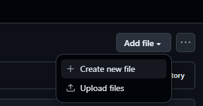
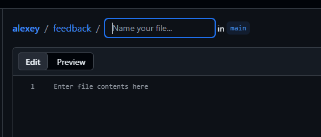
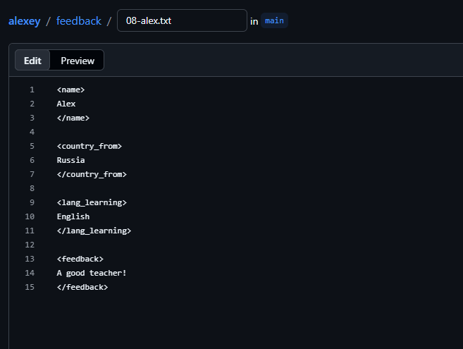
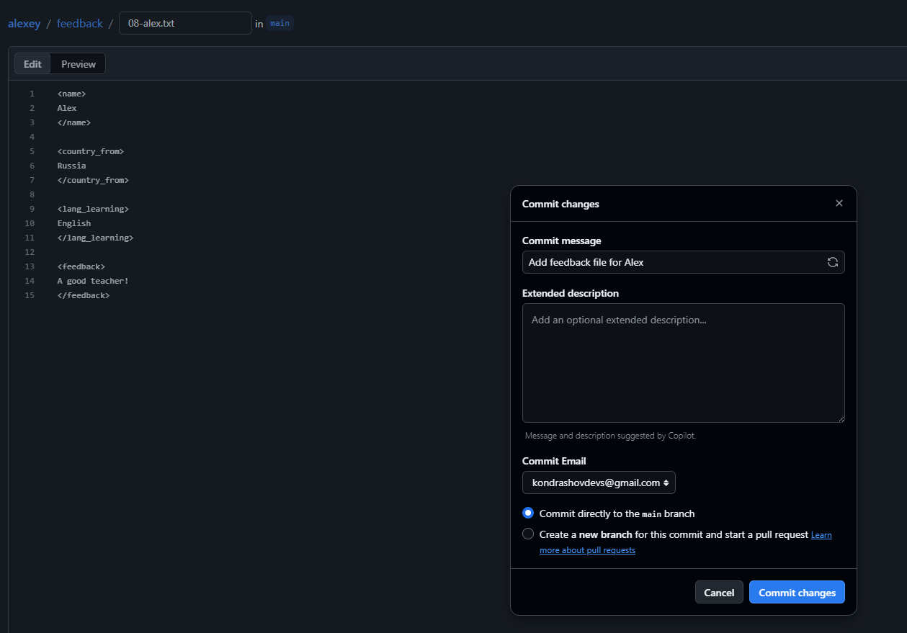

# Как добавить отзыв

**1. Сначала скопируй шаблон:**

```text
<name>
Alex
</name>

<country_from>
Russia
</country_from>

<lang_learning>
English
</lang_learning>

<feedback>
A good teacher!
</feedback>
```

**2. Создай файл:** **Add file → Create new file** в папке `feedback`.



**3. Назови файл**, например `08-alex.txt`: свободный номер от `01` до `99`, дефис и имя маленькими латинскими буквами. Один файл — один отзыв, номера не повторяются.



**4. Вставь скопированный шаблон** в редактор и замени текст внутри тегов. Заполни все четыре поля, сами теги оставь без изменений.



**5. Сохрани отзыв.** Нажми **Commit changes**, выбери **Commit directly to the main branch** и подтверди кнопкой **Commit changes**. После сборки отзыв появится на сайте автоматически.


